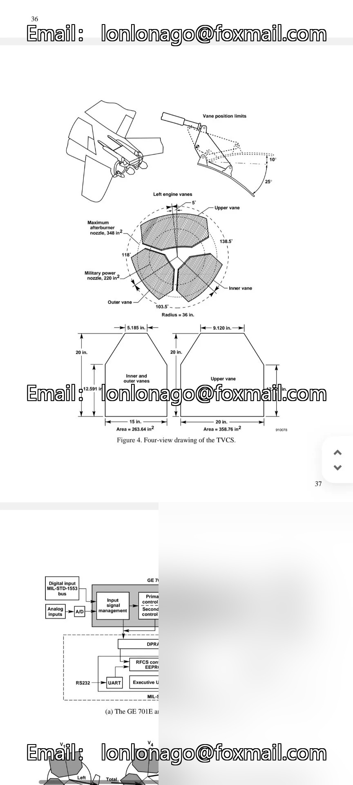
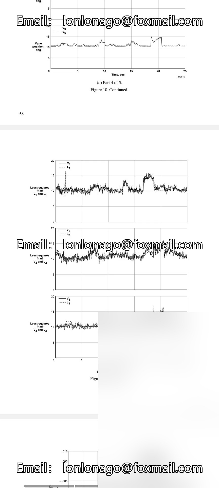
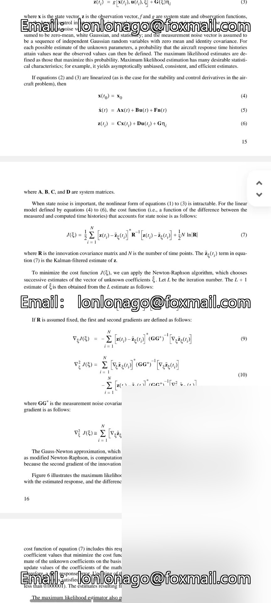

# F-18 HARV Project: NASA launched the high sweep angle at 80 to 90 years ago.

## Body

F-18 HARV Project: The core carrier of NASA's High-Appressure Technology Plan (HATP) launched from the 1980s to the 1990s. The aircraft is based on the early F/A-18 prototype retrofitted, specially used to study the aerodynamic characteristics and control capabilities of fighter jets under extreme high appendage angle (up to 60° to 70°).
Ampere aero-pitch and thrust vector coupling mechanism assessment: the document reveals the dynamic response characteristics of the F-18 HARV under traditional aerodynamic and thrust vector coupling control states. Mastering aerodynamic data and control strategies under these extreme operating conditions helps gain an in-depth understanding of the underlying logic of the US military in advanced fighter jet slipstream maneuvers and overwing maneuvers, providing a basis for formulating targeted tactical countermeasures.
5701
upon sale.

The F-18 HARV project is NASA's high-slope-angle technology plan launched from the 1980s to the 1990s; the aircraft is based on an early F/A-18 prototype, with details covering high-slope angles (60° to 70°), vane limits, engine and nozzle components, power parameters and multiple view systems and control mechanisms.

<!-- AI_ENRICHED -->

## Images

## Payment

Here is a pay link on Stripe ( https://buy.stripe.com/3cs8yP7sY87d0vu9AB ). Please contact me lonlonago@foxmail.com after funding $89, and I will send you a complete data files , thank you!

